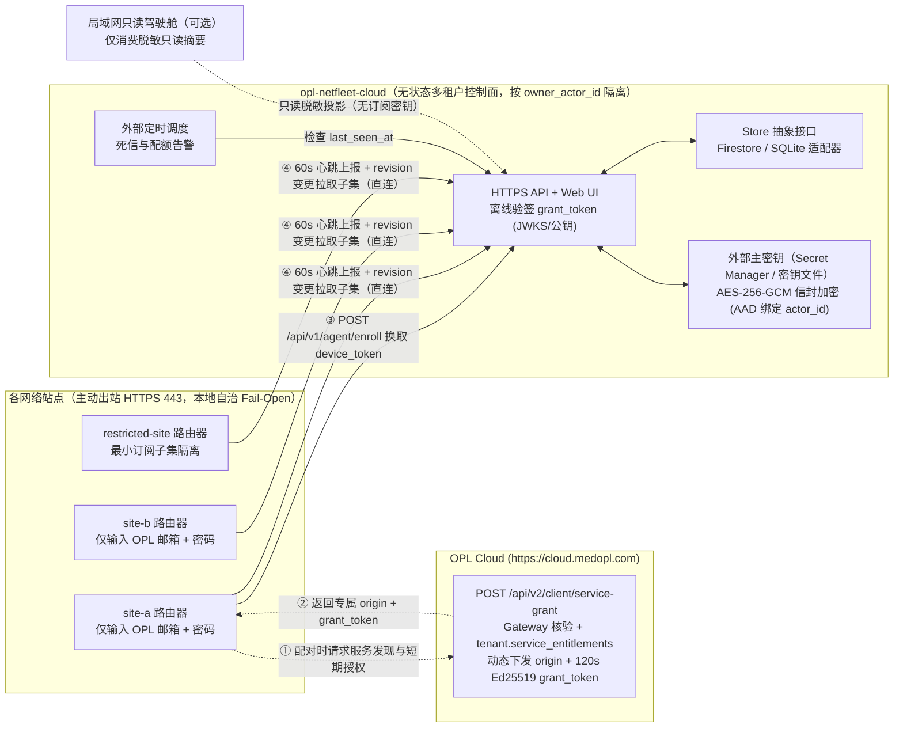

# OPL NetFleet Cloud 多站点集中监视与订阅同步控制面

> 状态：`proposal`（演进设计 SSOT）。Phase 1 单管理员控制面源码（`cloud/`）与默认安装的设备同步插件（`plugins/site-sync/`）已进入当前源码；本文同时作为 **Phase 2 多用户租户隔离（`owner_actor_id`）、OPL Cloud 统一权益与零手填地址自动发现、以及产品与生产实例彻底分离** 的架构 SSOT，不能替代实际实例部署与运行期回执。

## 背景与产品定位

`opl-netfleet` 原先以单设备为管理单位，在各设备独立完成订阅拉取、策略编译、自动选路与故障恢复。当用户或运维方在多个物理位置部署多台路由器（包括严格 NAT、蜂窝网络或无公网入站链路的环境）时，面临两项共性需求：

1. **多站点性能集中监视**：在同一面板查看自己全部站点的在线状态、当前运行模式、各能力实际选中的出口地区与节点、实测出口 RTT、实时上下行速率、累计流量、订阅剩余配额以及降级恢复状态。
2. **统一加密订阅池与最小权限子集分发**：在云端集中维护多机场订阅源，并为不同站点勾选各自获准同步的订阅子集（例如 `site-a`、`site-b` 同步全量主备订阅池，而位于半可信物理环境或受限网络的 `restricted-site` 仅被授权拉取其中的 `provider-a` 单一订阅），改配后自动安全下发并由设备端完成本地事务更新。

### 命名与产品/实例分离

- **命名**：本服务命名为 **`opl-netfleet-cloud`**，以区别于定位于“可信局域网内无登录只读常亮驾驶舱”的 `opl-fleet-cockpit`。前者承担跨网络收敛、多租户隔离、带权限控制与加密订阅分发的云端读写控制面角色。
- **软件源码与生产实例分离**：
  - **公开产品仓库（`gaofeng21cn/opl-netfleet`）**：`cloud/` 与 `plugins/site-sync/` 仅持有通用、可自托管的多租户控制面源码、容器镜像构建与设备同步插件，共享 `capability`、`provider`、`section`、`subscription`、`region` 领域语义；**绝不向本仓提交生产域名、临时托管地址、个人邮箱、站点清单、订阅内容或部署密钥**。
  - **官方生产实例（`opl-instance-medopl`）**：面向全部 OPL Gateway 用户的单一官方云端生产服务由独立生产 Instance 仓库治理（域名接入、OPL Cloud 服务目录绑定、运行载体选择、密钥引用、部署流与脱敏验收回执）。开源用户也可基于同一份容器镜像零改动自托管。

## 总体架构

采用 **「OPL Cloud 统一入口发现与发证 + 设备主动出站 HTTPS 443 + 无状态短连接多租户控制面 + 可插拔持久化层」** 模型，天然穿透严格 NAT 与蜂窝上游，不依赖公网入站端口、路由器端口映射或统一组网隧道。

## 可移植设计与零锁定边界

为兼顾无服务器平台（如 Cloud Run `min-instances=0`）的极低空闲成本以及在自有 Docker 主机 / VPS / TKE Kubernetes 上的可迁移性，服务端遵守以下架构约束：

1. **标准无状态短连接容器**：使用 Node 22 + TypeScript 构建单一容器镜像与前端静态资源；全部交互均为短连接 HTTPS 请求，不维护浏览器与云端之间的常驻双向长连接状态，支持任意无服务器缩容至 0 或平滑迁移算力底座。
2. **控制面发现解耦接入**：路由器默认通过 OPL Cloud 统一入口获取当前有效的 `<netfleet-cloud-origin>`，无需人工记忆或输入长域名；云端日后更换载体或自定义域名时，只需更新 OPL Cloud 实例服务目录即可向新接入或重连客户端动态下发。
3. **极薄可插拔 `Store` 抽象**：业务层通过统一 `Store` 接口存取多租户站点快照、聚合时序、设备令牌哈希、订阅记录与分发矩阵，至少提供两类适配器：
   - **Firestore Native 适配器**：面向 Cloud Run 等无服务器托管，避免高固定月费关系型数据库及共享对象挂载上的文件锁竞争；
   - **SQLite 适配器**：面向单机 Docker / 自建 VPS / 挂载持久卷的轻量自托管场景。
4. **订阅密文信封保护**：所有上游订阅 URL 在写入持久化层前，须使用外部注入的 32 字节主密钥（如 Secret Manager 或宿主机只读密钥文件）经 AES-256-GCM 加密，并将 `owner_actor_id` 与 `subscription_id` 同时绑定进 GCM AAD；控制面列表与响应默认返回脱敏标识，仅授权站点的分发接口向对应设备解密返回其子集。

## 多用户租户隔离数据模型（`owner_actor_id`）

官方云端采用单一共享服务承接全部获准 OPL Gateway 用户的站点管理需求（除非用户选择自托管），服务端严格执行多租户强制隔离：

1. **不可变数字主体隔离**：所有 `sites`、`subscriptions`、站点分发矩阵、设备绑定与监控快照记录全部强绑定不可变数字 `owner_actor_id`（来自 OPL Cloud 签发的 JWT `sub` / `actor_id`），**绝不按可变邮箱地址作为数据归属主键**；所有读写、列表、修改、删除与导出接口均在仓储查询层强制过滤 `owner_actor_id`。其中 Firestore 存储优先采用租户前缀集合路径（`tenants/{owner_actor_id}/sites/{site_id}` 与 `tenants/{owner_actor_id}/subscriptions/{subscription_id}`）实现结构级路径隔离，同时逻辑分区键保留与未来共享 `tenant_id`（个人默认即 `owner_actor_id`）兼容的演进空间。
2. **设备与站点作用域隔离**：`site_id` 唯一性与 `device_id` 配对幂等（`POST /api/v1/agent/enroll`）严格限定在同一 `owner_actor_id` 作用域内；不同用户各自拥有独立的站点命名空间，绝不允许用户 B 凭设备 ID 覆盖、接管或探测用户 A 的已绑定路由器。
3. **加密上下文与配额边界**：每条加密订阅的 AES-256-GCM AAD 绑定 `owner_actor_id + subscription_id`，从密码学上阻断跨租户密文重放；配对前服务端核验 OPL Cloud `grant_token` 携带的 `limits`（例如单用户最大站点数 `max_sites`）与现有站点数上限。
4. **自托管同模兼容**：自托管部署（单用户或本地运维）复用同一套 `owner_actor_id` 模型，不维护单租户与多租户两套分支数据结构。

## 双轨鉴权、零手填地址自动发现与自托管边界

系统严格区分“人类运维人员会话”与“路由器设备长期凭证”，并由 OPL Cloud 作为用户身份、功能权益与服务端点发现的统一控制点：

### 1. 官方 OPL Cloud 模式（默认：零手填云端地址）

- **设备端极简接入**：OpenWrt LuCI（`服务 → OPL NetFleet → 云端站点同步`）与 CLI（`site-sync-enroll`）默认仅需用户输入 **OPL 账号（邮箱）+ 密码**（及可选站点名称 / 二步验证码），无需手动输入或记住 `opl-netfleet-cloud` URL。
- **两步票据交换**：
  1. 路由器向官方 OPL Cloud 发现入口（默认 `https://cloud.medopl.com/api/v2/client/service-grant`）提交 `{ email, password, totp_code?, service: "netfleet_cloud" }`；OPL Cloud 内部向 OPL Gateway 校验账号并查询 `tenant.service_entitlements`。未获授权或已停用账号直接返回 `403 service_not_entitled`，**不下发服务地址**；获准账号收到动态下发的 `{ origin, grant_token, limits, expires_at }`（`grant_token` 为 120 秒有效期 Ed25519 签名 JWT）。
  2. 路由器严格校验下发 `origin`（强制 `https://`、合法域名、拒绝私网/回环 SSRF、禁用 HTTP 重定向），**立即销毁内存中的密码（绝不落盘，也绝不发送给 `opl-netfleet-cloud`）**，随后持短期 `grant_token` 调用 `POST <origin>/api/v1/agent/enroll` 换取单站隔离的长期 `device_token` 并持久化到 `0600` 本地配置。
- **云端无状态离线验签**：`opl-netfleet-cloud` 仅配置 OPL Cloud 公钥（JWKS 或 `OPL_CLOUD_GRANT_PUBLIC_KEY`），本地离线校验 `grant_token` 的签名、`iss`、`aud="opl-netfleet-cloud"`、`exp`、`scope` 与数字 `sub`，**彻底淘汰按环境变量维护静态邮箱白名单（`OPL_NETFLEET_CLOUD_ADMIN_EMAILS`）的机制**，在保持 Cloud Run scale-to-zero 的同时让 OPL Cloud 权益开关即时生效。
- **Web 管理台同步收口**：人类用户在浏览器登录 `opl-netfleet-cloud` Web UI 时，后端同样通过 OPL Cloud `service-grant`（或 Console 跳转的短期 SSO 票据）核验权益并写入短期 `HttpOnly` / `SameSite` 会话 Cookie，实现统一账号权限管理与免密扩展能力。
- **上游解耦红利**：路由器与插件只感知统一的 `<cloud-origin>` 与标准化 `grant_token`，未来 OPL Cloud 底层替换认证后端或接入 OIDC 联邦时，现场设备无需升级即可平滑兼容。

### 2. 自托管兼容模式（默认折叠「高级设置」）

- LuCI「云端站点同步」与 CLI 在默认折叠的「高级设置」中保留两项可选覆写：
  1. **自定义 OPL Cloud 地址**：对接私有自建 OPL Cloud 实例完成发现与发证；
  2. **直连自托管 NetFleet Cloud**：显式填写自建 `<manager-origin>`，走原有直连校验路径（后端仅在明确启用自托管模式时保留 `IdentityProvider` 直连与静态管理员配置 fallback），保持开源自托管零门槛与向后兼容。

### 3. 设备端 Agent：单站点独立 Token + 最小权限子集 + 故障域隔离

- 每个已纳管站点在云端拥有独立的设备记录，签发高熵随机 43 字符 `Device Token`；服务端数据库**只保存单向 SHA-256 哈希**，并将凭证强绑定到 `(owner_actor_id, site_id)`。
- 凭 `restricted-site` 的设备 Token 调用分发接口时，云端严格只返回在站点矩阵中显式勾选给 `restricted-site` 的订阅记录；即便物理设备遗失，一键吊销该站点 Token 即可瞬时止损，且人类账号改密或更换认证上游不影响已在线路由器的日常同步。
- **故障域与权限撤销边界**：配对完成后，每 60 秒心跳与订阅拉取直连下发的 `<origin>`，**不再依赖 OPL Cloud 实时在线**；管理员在 OPL Cloud 关闭某用户 `netfleet_cloud` 权益后，立即阻断该用户所有新设备配对与 Web 管理台登录，已纳管路由器本地代理配置严格保持 Fail-Open 不中断家庭/实验室网络（需要停机踢出时由控制面显式吊销对应 `device_token`）；若服务端迁移域名，设备**严禁裸跟随 HTTP 302 重定向**，需通过受信任的发现刷新路径重新确认 `origin`。

## 设备端插件与 Fail-Open 安全底线

设备端能力通过 `opl-netfleet` 既有插件体系以默认随系统安装的独立包 **`opl-netfleet-plugin-site-sync`** 落地（纯 UCode 复用设备既有工具链，不向资源受限路由器引入 Node 或 Python 运行时）。未启用配对的设备保持纯单机静默行为不变。

### 两条主动出站接口

1. **周期心跳：`POST /api/v1/agent/heartbeat`（默认 60 秒）**
   - 设备仅上报[架构总览](../architecture/overview.md)与既有隐私原则允许的白名单聚合字段：运行模式、各启用能力的当前选中地区/机场 section/实测出口 RTT、核心实时上下行速率与累计流量、订阅已记录配额、当前 `applied_revision`、最近脱敏事件摘要（含错误 ID 与恢复状态）。
   - **严禁上报**：局域网内任何客户端 IP 或 MAC、访问域名或 URL 明细、设备登录凭据、SSH 路由、未脱敏机场 URL 或原始核心日志。
   - 服务端响应携带 `{ desired_revision, server_time }`。任何云端订阅或勾选矩阵变更都会递增对应受影响站点的 `desired_revision`，使现场设备在不保持长连接的前提下于 1 个心跳周期内自动感知变更。
2. **按需同步：`GET /api/v1/agent/subscriptions`**
   - 仅当心跳返回的 `desired_revision != applied_revision` 时触发。
   - 设备拿到授权子集后，**严禁直接修改 Mihomo 运行配置或覆盖本地全部配置**；必须严格按当前平台现有事务链校验输入并通过 `subscriptions-set` -> `refresh` -> `compile` 完成原子编译、切换、健康探测与回读，再将新的 `applied_revision` 随下次心跳写回云端。

### 不可违背的自治与恢复边界

- **云端故障绝不阻断本地网络**：云端不可达、DNS 波动、TLS 校验失败、服务端返回非 200 状态或空集合（除非云端显式确认且策略允许）、或本地订阅拉取/编译失败时，设备严格保留原有本地订阅与有效 Profile，维持 DIRECT-first 护栏并记录有界脱敏诊断回执，**绝不清空当前有效配置**。
- **配置解耦保留**：各站点专属的上游 DNS（如光猫网关或蜂窝上游地址）、网络接入参数、本地业务规则、Policy Source 与 Recovery Profile 继续由设备端独立持有与维护；云端在 Phase 1–2 只负责集中监视与订阅源子集分发。
- **不可逆操作禁区**：沿用 `opl-netfleet` 安全下限，云端接口永不授权下发或触发 `reboot`、`poweroff`、`sysupgrade`、`firstboot` 等物理或固件层动作。

## 与其他能力及生态服务的协同

1. **外部死信告警（Dead Man's Switch）**：利用云端已有定时器/调度器周期扫描各站点的 `last_seen_at` 与降级状态，在某站点离线超过阈值、持续处于降级恢复模式或订阅剩余流量低于阈值时触发外部通知，直接合一覆盖跨站点失联监测需求。
2. **与局域网 `opl-fleet-cockpit` 协同**：`opl-netfleet-cloud` 未来可提供受控的只读脱敏投影端点，仅暴露站点在线状态、选中出口能力与聚合延迟/吞吐，严禁任何订阅凭据、原始地址或写接口进入局域网无登录展示面。

## 分阶段演进与准入验收要求

| 阶段 | 交付范围 | 必须满足的准入与验收门禁 |
| --- | --- | --- |
| **Phase 1：单管理员 MVP 闭环** | ① 无状态服务端容器（`IdentityProvider` + `Firestore`/`SQLite` `Store` + AES-256-GCM 信封加密）；② 全中文现代 Web UI、账号密码直登、站点总览与加密订阅矩阵；③ 纯 UCode 插件 `opl-netfleet-plugin-site-sync`（默认安装） | 服务端单元/集成测试与真实持久化 E2E 通过；设备插件通过仓库 OpenWrt QEMU 隔离资格验收及可恢复 Canary 实机闭环 |
| **Phase 2：多租户隔离 + OPL Cloud 零地址自动发现** | ① 全栈按 `owner_actor_id` 改造站点/订阅/令牌/GCM AAD 租户隔离并支持配额上限；② 接入 OPL Cloud `service-grant` Ed25519 离线验签（淘汰静态邮箱白名单）；③ `site-sync` LuCI/CLI 默认仅填 OPL 账号密码自动发现 `origin`，高级设置保留自托管覆写；④ 官方多用户生产实例正式划归 `opl-instance-medopl` 治理 | 证明不同 `owner_actor_id` 间站点/订阅/设备配对与加密信封完全隔离、越权与停用权益返回 403 且不泄露地址、OpenWrt QEMU 资格验收通过发现/SSRF 防护/Fail-Open 边界，以及 `opl-instance-medopl` 双账号实测回读闭环 |
| **Phase 3：生态扩展（按需）** | ① 面向局域网 Cockpit 的只读脱敏投影；② 接入定时死信巡检、配额低位提醒与多时段延迟/流量趋势；③ 评估受限审计级“远程触发一次订阅刷新 / 选优”指令（不开放任意配置覆写） | 证明不改变局域网 Cockpit 隐私零秘密边界，受限指令经设备本地 mutation lock 校验并保留 Fail-Open 恢复 |
