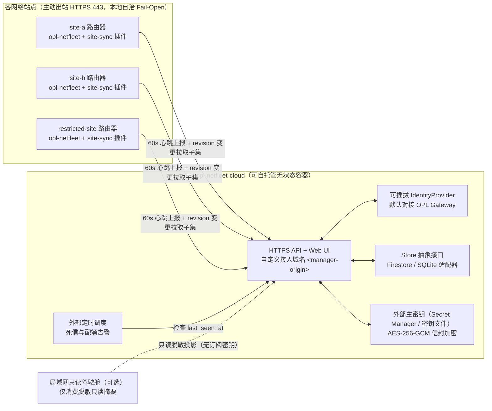

# OPL NetFleet Cloud 多站点集中监视与订阅同步控制面

> 状态：`proposal`（待实现架构方案）。本提案尚未进入[当前架构](../architecture/overview.md)或实现，不能替代设备既有自治能力、真实 caller 与验收证据。

## 背景与产品定位

`opl-netfleet` 目前以单设备为管理单位，在各设备独立完成订阅拉取、策略编译、自动选路与故障恢复。当同一运维方在多个物理位置部署多台路由器（包括严格 NAT、蜂窝网络或无公网入站链路的环境）时，面临两项共性运维需求：

1. **多站点性能集中监视**：在同一面板查看全部站点的在线状态、当前运行模式、各能力实际选中的出口地区与节点、实测出口 RTT、实时上下行速率、累计流量、订阅剩余配额以及降级恢复状态。
2. **统一加密订阅池与最小权限子集分发**：在云端集中维护多机场订阅源，并为不同站点勾选各自获准同步的订阅子集（例如 `site-a`、`site-b` 同步全量主备订阅池，而位于半可信物理环境或受限网络的 `restricted-site` 仅被授权拉取其中的 `provider-a` 单一订阅），改配后自动安全下发并由设备端完成本地事务更新。

### 命名与仓库归属

- **命名**：本服务命名为 **`opl-netfleet-cloud`**，以区别于定位于“可信局域网内无登录只读常亮驾驶舱”的 `opl-fleet-cockpit`。前者承担跨网络收敛、带权限控制与加密订阅分发的云端读写控制面角色。
- **归属**：通用、可自托管的产品服务端与配套设备插件作为 `opl-netfleet` 的组成部分演进（规划位于本仓 `cloud/` 与设备插件目录），共享 `capability`、`provider`、`section`、`subscription`、`region` 领域语义；私有站点清单、域名、凭据与具体云账号配置仍留在各自私有 OPL Instance，绝不进入本仓库。

## 总体架构

采用 **「设备主动出站 HTTPS 443 + 无状态短连接云端控制面 + 可插拔持久化层」** 模型，天然穿透严格 NAT 与蜂窝上游，不依赖公网入站端口、路由器端口映射或统一组网隧道。

## 可移植设计与零锁定边界

为兼顾无服务器平台（如 Cloud Run `min-instances=0`）的极低空闲成本以及在自有 Docker 主机 / VPS / Kubernetes 上的可迁移性，服务端遵守以下架构约束：

1. **标准无状态短连接容器**：使用 Node 22 + TypeScript 构建单一容器镜像与前端静态资源；全部交互均为短连接 HTTPS 请求，不维护浏览器与云端之间的常驻双向长连接状态，支持任意无服务器缩容至 0 或单机平滑迁移。
2. **自定义域名隔离接入**：设备端与浏览器只接入运营方自有自定义域名（`<manager-origin>`），不绑定特定云厂商分配的默认入口域名，以应对跨云迁移及不同接入线路的可达性波动。
3. **极薄可插拔 `Store` 抽象**：业务层通过统一 `Store` 接口存取站点快照、聚合时序、设备令牌哈希、订阅记录与分发矩阵，至少提供两类适配器：
   - **Firestore Native 适配器**：面向 Cloud Run 等无服务器托管，避免高固定月费关系型数据库及共享对象挂载上的文件锁竞争；
   - **SQLite 适配器**：面向单机 Docker / 自建 VPS / 挂载持久卷的轻量自托管场景。
4. **订阅密文信封保护**：所有上游订阅 URL 在写入持久化层前，须使用外部注入的 32 字节主密钥（如 Secret Manager 或宿主机只读密钥文件）经 AES-256-GCM 加密；控制面列表与响应默认返回脱敏标识，仅授权站点的分发接口向对应设备解密返回其子集。

## 双轨鉴权与账号防耦合边界

系统严格区分“人类运维人员管理会话”与“路由器设备自动化凭证”，避免在 NetFleet 体系内额外造出第三套平行用户名密码体系，同时防止外部账号服务演进对现场设备造成断联冲击：

### 1. 人类管理员 Web UI：薄适配对接，零平行密码库
- 服务端定义约 30 行的 `IdentityProvider` 接口，输入客户端提交的 Bearer 凭据，输出标准化主体 `{ subject, email, role }`，并映射为云端内部稳定的 `owner_id`；**禁止让上游网关私有字段直接侵入订阅库与站点模型**。
- 默认提供 `OplGatewayIdentityProvider` 适配器，向可配置的 `<gateway-origin>/api/v1/auth/me` 核验身份并执行白名单准入，核验成功后签发短期、HttpOnly、SameSite 的控制面会话 Cookie。
- 未来若整个生态将认证收敛到统一身份服务或 OIDC，只需替换该单文件适配器并保持 `owner_id` 映射连续性，已接入的路由器站点与订阅策略无需迁移或停服。

### 2. 设备端 Agent：单站点独立 Token + 最小权限子集
- 每个已纳管站点在云端拥有独立的设备记录，签发高熵随机 `Device Token`；服务端数据库**只保存单向 SHA-256 哈希**，并将凭证强绑定到唯一 `site_id`。
- 凭 `restricted-site` 的设备 Token 调用分发接口时，云端严格只返回在站点矩阵中显式勾选给 `restricted-site` 的订阅记录；即便物理设备在半可信环境中遗失，也不会暴露其他站点的订阅来源，云端一键吊销该站点 Token 即可瞬时止损。
- 人类管理员账号改密、轮转 2FA 或更换认证上游时，**不会影响在线路由器的心跳与订阅同步**。

## 设备端插件与 Fail-Open 安全底线

设备端能力通过 `opl-netfleet` 既有插件体系以独立可选包 **`opl-netfleet-plugin-site-sync`** 落地（优先纯 UCode 复用设备既有工具链，不向资源受限路由器引入 Node 或 Python 运行时）。未安装或未启用该插件的设备保持纯单机行为不变。

### 两条主动出站接口

1. **周期心跳：`POST /api/v1/agent/heartbeat`（默认 60 秒）**
   - 设备仅上报[架构总览](../architecture/overview.md)与既有隐私原则允许的白名单聚合字段：运行模式、各启用能力的当前选中地区/机场 section/实测出口 RTT、核心实时上下行速率与累计流量、订阅已记录配额、当前 `applied_revision`、最近脱敏事件摘要（含错误 ID 与恢复状态）。
   - **严禁上报**：局域网内任何客户端 IP 或 MAC、访问域名或 URL 明细、设备登录凭据、SSH 路由、未脱敏机场 URL 或原始核心日志。
   - 服务端响应携带 `{ desired_revision, server_time }`。任何云端订阅或勾选矩阵变更都会递增对应受影响站点的 `desired_revision`，使现场设备在不保持长连接的前提下于 1 个心跳周期内自动感知变更。
2. **按需同步：`GET /api/v1/agent/subscriptions`**
   - 仅当心跳返回的 `desired_revision != applied_revision` 时触发。
   - 设备拿到授权子集后，**严禁直接修改 Mihomo 运行配置或覆盖本地全部配置**；必须严格按当前平台现有事务链校验输入并通过 `subscriptions-set` -> `refresh` -> `compile` 完成原子编译、切换、健康探测与回读，再将新的 `applied_revision` 随下次心跳写回云端。

### 不可违背的自治与恢复边界

- **云端故障绝不阻断本地网络**：云端不可达、DNS 波动、TLS 校验失败、服务端返回非 200 状态或空集合（除非云端显式确认且策略允许）、或本地订阅拉取/编译失败时，设备严格保留原有本地订阅与有效 Profile，维持 DIRECT-first 护栏并记录有界脱敏诊断回执，**绝不清空当前有效配置**。
- **配置解耦保留**：各站点专属的上游 DNS（如光猫网关或蜂窝上游地址）、网络接入参数、本地业务规则、Policy Source 与 Recovery Profile 继续由设备端独立持有与维护；云端在 Phase 1–2 只负责集中监视与订阅源子集分发。
- **不可逆操作禁区**：沿用 `opl-netfleet` 安全下限，云端接口永不授权下发或触发 `reboot`、`poweroff`、`sysupgrade`、`firstboot` 等物理或固件层动作。

## 与其他能力及生态服务的协同

1. **外部死信告警（Dead Man's Switch）**：利用云端已有定时器/调度器周期扫描各站点的 `last_seen_at` 与降级状态，在某站点离线超过阈值、持续处于降级恢复模式或订阅剩余流量低于阈值时触发外部通知，直接合一覆盖跨站点失联监测需求。
2. **与局域网 `opl-fleet-cockpit` 协同**：`opl-netfleet-cloud` 未来可提供受控的只读脱敏投影端点，仅暴露站点在线状态、选中出口能力与聚合延迟/吞吐，严禁任何订阅凭据、原始地址或写接口进入局域网无登录展示面。

## 分阶段演进与准入验收要求

| 阶段 | 交付范围 | 必须满足的准入与验收门禁 |
| --- | --- | --- |
| **Phase 1：最小闭环** | ① 服务端基础镜像（`IdentityProvider` + `Firestore`/`SQLite` `Store` + AES-256-GCM 信封加密）；② 多站点状态总览页与订阅池/站点分发矩阵页；③ 纯 UCode 设备插件 `opl-netfleet-plugin-site-sync` | 服务端通过单元与接口集成测试；设备插件先经仓库 OpenWrt QEMU 隔离资格验收（含心跳、`revision` 同步、断网/坏数据 Fail-Open 回滚），再在单个可恢复 Canary 设备完成实机闭环 |
| **Phase 2：多站推广与哨兵** | ① 推广至多站点与受限网络站点验证最小子集隔离；② 接入定时死信巡检、配额低位提醒与多时段延迟/流量趋势；③ 实测直连与代理链路下的自定义域名可达性 | 验证受限站点 Token 无法获取未授权订阅、单个站点断网后死信告警按期触发，且各站点逐一取得独立 fresh readback |
| **Phase 3：生态扩展（按需）** | ① 面向局域网 Cockpit 的只读脱敏投影；② 评估是否开放“触发一次远程订阅刷新 / 选优”的审计级受限指令（不开放任意配置覆写） | 证明不改变局域网 Cockpit 隐私零秘密边界，受限指令经设备本地 mutation lock 校验并保留 Fail-Open 恢复 |
